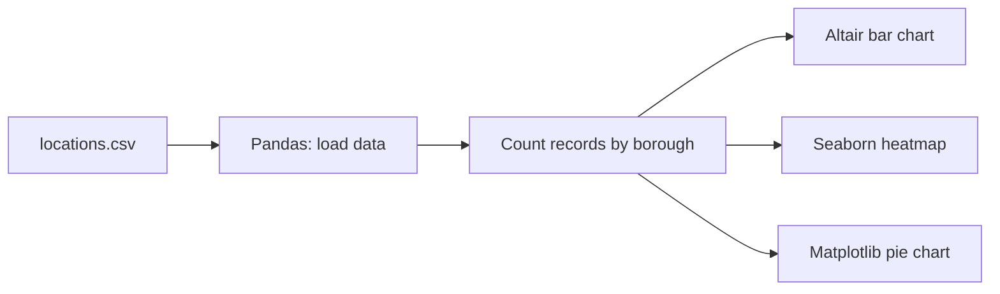

# 🗽 NYC Boroughs — Location Data Visualization

Exploratory analysis of **96,030 New York City location records** using Python, with interactive and static visualizations showing how records are distributed across the five boroughs.

## Overview

This project reads a CSV dataset containing borough codes and street-location information, groups records by borough, and visualizes the results in three ways:

- **Interactive bar chart:** Altair chart with borough-level counts and hover tooltips.
- **Heatmap:** Seaborn heatmap comparing counts across boroughs.
- **Pie chart:** Matplotlib chart showing each borough's proportion of the dataset.

The source notebook calls these records “connections”; the analysis counts rows grouped by the `boro` column and does not independently measure connectivity.

## Visualizations

### Borough Distribution Heatmap


### Borough Distribution Pie Chart


### Interactive Borough Chart


[Open the interactive Altair chart](interactive_borough_chart.html) — download and open the HTML file in a browser to interact with the chart.

## Dataset

The `locations.csv` file contains **96,030 rows** with the columns `boro`, `order_no`, `main_st`, `from_st`, `to_st`, and `sos`.

| Borough code | Records |
| --- | ---: |
| K | 33,774 |
| Q | 27,917 |
| B | 14,182 |
| M | 13,261 |
| S | 6,896 |

The visualizations use the borough codes as they appear in the CSV.

## Tech Stack

**Python · Pandas · Altair · Matplotlib · Seaborn · Jupyter Notebook**

## Project Structure

```text
.
├── README.md
└── python_notebooks/
    ├── Hw6.ipynb
    ├── locations.csv
    ├── interactive_borough_chart.html
    └── assets/
        ├── borough_heatmap.png
        └── connection_pie_chart.png
```

## Run Locally

1. Clone or download this repository.
2. Install the notebook dependencies:

   ```bash
   pip install pandas altair seaborn matplotlib notebook
   ```

3. Open the project folder and start Jupyter:

   ```bash
   cd python_notebooks
   jupyter notebook Hw6.ipynb
   ```

4. Run the notebook cells. It reads `locations.csv` from the working directory and generates the interactive HTML chart and two image files inside `assets/`.

## Analysis Workflow



---

*This README documents the NYC borough analysis notebook and its outputs, separate from the unrelated Jekyll portfolio template files.*
